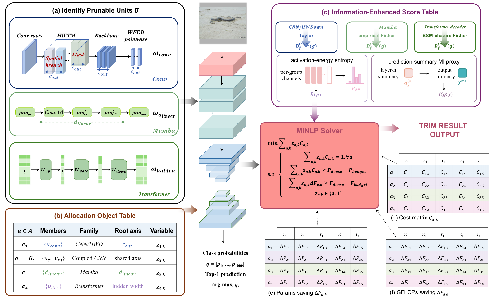

# TRIM: Dual-Budget Structured Pruning with Information-Modulated Saliency for CNN, Transformer, and Mamba Vision Models

**Tri-family Resource-constrained Information Modulation**

Weizheng Wang, Junyi Wu, Qing Tian, and Liqin Tian

Weizheng Wang and Junyi Wu contributed equally. Liqin Tian is the corresponding author.

## Abstract

Convolutional, Transformer, and selective state-space vision models expose different prunable dimensions. A compression budget satisfied by an analytical cost model may also be violated after physical pruning. TRIM addresses structured pruning under simultaneous parameter and forward-GFLOP constraints through dependency-closed structural units and family-aware Taylor or empirical-Fisher saliency, modulated by activation-energy entropy and prediction-aligned mutual information. Coupled allocation resolves shared-axis dependencies, and mixed-integer linear programming selects width reductions. The selection is materialized and repaired against remeasured model complexity. The paper reports Top-1 losses of 0.52, 0.66, and 0.58 percentage points on ImageNet-1K for ResNet-50, DeiT-Base/16, and VMamba-V2 Tiny, respectively, retaining at most 69.5% of parameters and 69.4% of forward GFLOPs with zero measured budget violation.

## 1. Method

### 1.1 Dependency-closed structural units

Each pruning action removes a structural axis together with its dependent tensor slices.

| Family | Prunable axis | Parameter closure |
| --- | --- | --- |
| CNN | Convolution output channels | Root filters, propagated consumer inputs, and normalization channels |
| Transformer | Feed-forward hidden width | Input-projection rows and output-projection columns; paired gate/value rows for gated FFNs |
| Mamba / SSM | Inner width, `d_inner` | Input projection, depthwise convolution, state/time projections, state parameters, and output projection |

Candidate retention ratios are drawn from `{1.0, 0.875, 0.75, 0.625, 0.5}`, subject to legal widths and operator grouping constraints.

### 1.2 Information-modulated saliency

CNN units use first-order Taylor sensitivity. Transformer and Mamba units use a diagonal squared-gradient empirical-Fisher proxy. For unit `g` and channel `c`, the modulated score is

$$
s_{g,c}=b_{g,c}\left(1+\lambda_H\widehat H_g+\lambda_I\widehat I_g\right),
\qquad \lambda_H=\lambda_I=0.25.
$$

Normalized activation-energy entropy measures the distribution of energy across channels. The paper estimates normalized mutual information between each unit's mean absolute activation and the mean of the model's top-five class scores, using 16 histogram bins and numerical stabilization of `1e-12`. The multiplier is shared by all channels in a unit. It preserves their relative ranking while changing the allocation of pruning across units.

### 1.3 Coupled dual-budget allocation

Roots sharing a propagated axis are combined into compatible allocation objects. Binary variable `z[a,k]` selects candidate `k` for object `a`, with information-loss cost `C[a,k]` and predicted resource savings. TRIM solves

$$
\begin{aligned}
\min_z\quad &\sum_{a,k}C_{a,k}z_{a,k}\\
\text{subject to}\quad &\sum_k z_{a,k}=1 \quad \forall a,\\
&\sum_{a,k}\Delta P_{a,k}z_{a,k}\ge(1-\rho_P)P_0,\\
&\sum_{a,k}\Delta F_{a,k}z_{a,k}\ge(1-\rho_F)F_0,\\
&z_{a,k}\in\{0,1\}.
\end{aligned}
$$

### 1.4 Materialization and measured-budget repair

The pruning implementation physically applies selected widths, checks forward compatibility, remeasures parameters and forward GFLOPs, and repairs remaining excess through reallocation and supported local or coupled moves. Acceptance requires both measured budgets to hold; an unsuccessful repair rejects the configuration.



**Figure 1.** Original pipeline figure from the paper, showing family-specific pruning units, coupled allocation objects, information-modulated saliency, and parameter/GFLOP savings for dual-budget allocation.

## 2. Experimental Protocol and Manuscript Results

### 2.1 Evaluation protocol

The paper evaluates ImageNet-1K classification using ResNet-50, DeiT-Base/16, and VMamba-V2 Tiny on the standard 50,000-image validation split. Every pruned variant targets `P/P0 <= 0.70` and `F/F0 <= 0.70`. Calibration uses 1,024 images sampled uniformly without replacement from the training split, forming 16 batches. Post-pruning recovery follows the corresponding pretrained model's training recipe, including optimizer, learning-rate schedule, and training duration. Variants within each family share the dense checkpoint, calibration batches, and recovery schedule.

| Model | Weight source | Prunable axis |
| --- | --- | --- |
| ResNet-50 | NVlabs MDP | Convolution output channels |
| DeiT-Base/16 | Official DeiT | FFN hidden width |
| VMamba-V2 Tiny | Official VMamba | Mamba inner width |

The tables below follow Tables 2 and 3 in the supplied paper. This snapshot does not include benchmark checkpoints or evaluation logs; the tables report the paper's results rather than new runs of this release.

### 2.2 Cross-family pruning (paper Table 2)

Taylor/Fisher and TRIM both use coupled allocation and budget repair in this comparison.

| Model | Variant | Top-1 (%) | Change (pp) | P/P0 | F/F0 |
| --- | --- | ---: | ---: | ---: | ---: |
| ResNet-50 | Dense | 76.18 | 0.00 | 1.000 | 1.000 |
| | Uniform | 74.00 | -2.18 | 0.698 | 0.699 |
| | Taylor/Fisher | 74.94 | -1.24 | 0.697 | 0.698 |
| | **TRIM** | **75.66** | **-0.52** | **0.694** | **0.692** |
| DeiT-Base/16 | Dense | 81.85 | 0.00 | 1.000 | 1.000 |
| | Uniform | 79.11 | -2.74 | 0.697 | 0.698 |
| | Taylor/Fisher | 80.39 | -1.46 | 0.698 | 0.696 |
| | **TRIM** | **81.19** | **-0.66** | **0.695** | **0.693** |
| VMamba-V2 Tiny | Dense | 82.58 | 0.00 | 1.000 | 1.000 |
| | Uniform | 80.12 | -2.46 | 0.696 | 0.697 |
| | Taylor/Fisher | 81.23 | -1.35 | 0.698 | 0.696 |
| | **TRIM** | **82.00** | **-0.58** | **0.693** | **0.694** |

`P0` and `F0` denote each dense model's parameter count and forward GFLOPs. Top-1 changes are percentage points relative to that family's dense checkpoint. Resource ratios do not establish device-specific latency improvements.

### 2.3 Information scoring and budget compliance (paper Table 3)

The first five rows use VMamba-V2 Tiny on ImageNet-1K at `(rho_P, rho_F) = (0.70, 0.70)`. Independent allocation omits both coupling and repair.

| Variant | Information term | Allocation | Change in Top-1 (pp) | Violation (%) |
| --- | --- | --- | ---: | ---: |
| Taylor | None | Independent | -1.35 | 2.8 |
| Taylor + entropy | Activation entropy | Independent | -1.02 | 2.5 |
| Taylor + MI | Prediction MI proxy | Independent | -0.91 | 2.4 |
| Family-specific | Entropy + MI | Independent | -0.72 | 2.1 |
| **Family-specific (TRIM)** | **Entropy + MI** | **Coupled + repair** | **-0.58** | **0.0** |
| NVlabs MDP (ResNet-50; separate reference) | Latency LUT | MGP + MDLM | -0.65 | 1.8 |

Budget violation is the largest relative excess over the two target budgets (paper Equation 12):

$$
\mathrm{Violation}=100\max\left(0,\frac{P}{\rho_P P_0}-1,\frac{F}{\rho_F F_0}-1\right).
$$

The independent Taylor control's 1.35 pp loss is measured on VMamba-V2 Tiny and carries 2.8% budget excess; the repaired Taylor/Fisher baseline in Table 2 has the same accuracy loss with zero excess. Coupling and repair together improve the family-specific variant by 0.14 pp and eliminate its 2.1% budget excess. The separate ResNet-50 MDP reference uses a latency objective and is not a controlled accuracy comparison with the VMamba ablations. The paper gives approximately 76.13% as the official MDP release's dense Top-1, distinct from the 76.18% dense anchor in Table 2.

## 3. Algorithm Package

This release contains the full TRIM pruning implementation and the operator definitions required by its structural adapters. Training loops, datasets, detector architectures, deployment tools, and experiment-manifest scaffolding are excluded.

```text
trim/
  pruner.py               TRIMPruner: calibration, candidate construction, and MILP selection
  adapters.py             Structural-unit collectors and host-model adapters
  allocation_types.py     Allocation candidates, objects, and coupled groups
  scoring.py              Entropy, mutual information, and prediction summaries
  coupling.py             Shared-axis compatibility and coupled allocation
  handlers.py             Operator-specific scoring, savings, and pruning actions
  structural_pruners.py   Frozen normalization, FFN, MLP, and Mamba closure slicing
  materialize.py          Physical pruning and forward validation
  repair.py               Measured-budget and actual-marginal repair
  complexity.py           Forward resource measurement
  artifact.py             Pruned-model serialization and loading
  runtime.py              Checkpoint, spatial-size, and device helpers
  block_gates.py          Optional block-level allocation support
  operators/
    feed_forward.py       FeedForwardMLP and SwiGLUFeedForward
    normalization.py      Convolution and frozen-normalization operators
    activations.py        Activation construction
    numerics.py           Mixed-precision arithmetic helpers
    common.py             Shared wavelet and state-space building blocks
    wavelet.py            WaveletDownsample operator
    wavelet_variants.py   Alternative wavelet-downsampling branches
    metadata.py           State-space checkpoint metadata and remapping
    scan.py               Spatial scan policies and route construction
figures/trim_pipeline.png  Figure 1 extracted directly from the paper
tests/                     Focused pruning-algorithm checks
```

All implementation modules live under `trim`. Use `trim.TRIMPruner` as the entry point and import operator types from `trim.operators`. Custom structural pruners are named `MLPWidthPruner`, `SwiGLUWidthPruner`, `MambaInnerWidthPruner`, and `FrozenBatchNormPruner`. Serialized tensor names and metadata keys retain the existing checkpoint format; pickled models containing previous Python module paths must be re-exported with this package layout.

## 4. Installation

Use Python 3.10 or later in an isolated project environment:

```bash
git clone https://github.com/4everWZ/TRIM.git
cd TRIM
python -m venv .venv
source .venv/bin/activate
python -m pip install -r requirements.txt
```

On Windows PowerShell, activate with `.venv\Scripts\Activate.ps1`. Dependencies include PyTorch, NumPy, SciPy's MILP solver, Torch-Pruning, and calflops. Mamba operators additionally require a compatible `mamba-ssm` installation and its runtime dependencies. Select the PyTorch/CUDA builds appropriate for your host model.

## 5. Algorithm Integration

TRIM consumes a host model, its loss module, and calibration batches. The retained integration expects `backbone` and `encoder` modules for dependency tracing, a model forward method accepting `targets`, and a criterion returning a dictionary of differentiable loss terms. Calibration batches are `(images, targets)`, where `targets` is a list of dictionaries containing tensors. Model outputs must include `pred_logits` for the prediction summary.

```python
from trim import TRIMPruner

# model, criterion, and calibration_loader are supplied by the host project.
pruner = TRIMPruner(
    model=model,
    criterion=criterion,
    device="cpu",  # Use a compatible CUDA device for Mamba models.
    input_shape=(1, 3, 224, 224),
    score_mode="family_specific_entropy_mi",
    candidate_ratios=(1.0, 0.875, 0.75, 0.625, 0.5),
)
result = pruner.prune(
    calibration_loader=calibration_loader,
    calibration_batches=16,
    target_param_ratio=0.70,
    target_gflops_ratio=0.70,
    artifact_dir="outputs/trim",
)
pruned_model = pruner.model
```

The default collectors retain their original host-module naming and type conventions. For another architecture, provide a collector through `pruner.unit_collectors` using the registry in `trim.adapters`, together with the necessary operator handlers and custom pruners. This repository does not supply complete ImageNet training or recovery pipelines for the three benchmark architectures.

The paper's information statistic uses the mean of the top-five class scores. The retained host integration uses the top 20 sigmoid detection scores by default in `trim.scoring.prediction_summary`; reproducing the classification protocol requires a host-specific prediction-summary adapter. This release preserves the existing pruning algorithm rather than claiming benchmark reproduction from the integration example.

Run the focused checks with:

```bash
python -m pytest tests -q
```

## 6. Citation

```bibtex
@misc{wang2026trim,
  title  = {TRIM: Dual-Budget Structured Pruning with Information-Modulated Saliency for CNN, Transformer, and Mamba Vision Models},
  author = {Wang, Weizheng and Wu, Junyi and Tian, Qing and Tian, Liqin},
  year   = {2026},
  url    = {https://github.com/4everWZ/TRIM}
}
```

## 7. Acknowledgments and Licensing

The retained operator adapters build on DEIM, DEIMv2, D-FINE, and RT-DETR. Original source notices are retained. The target repository's [MIT license](LICENSE) is preserved; inherited DEIM code remains subject to its original [Apache License 2.0](LICENSE-APACHE-2.0) and applicable file-level notices.
